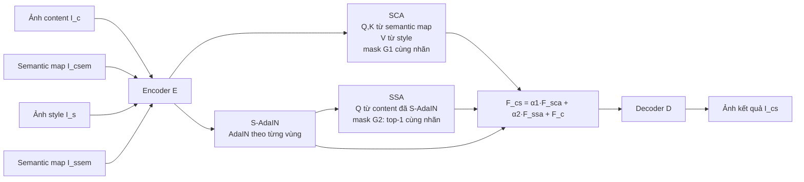

# Dàn ý hướng dẫn nghiên cứu cho seminar — SCSA

> **SCSA: A Plug-and-Play Semantic Continuous-Sparse Attention for Arbitrary Semantic Style Transfer** (CVPR 2025, Highlight)
> Chunnan Shang, Hongwei Wang, Zhizhong Wang, Xiangming Meng — Zhejiang University
> Paper: https://arxiv.org/abs/2503.04119 · Code: https://github.com/scn-00/SCSA
> Soạn ngày 2026-10-18. Số liệu trong tài liệu đã đối chiếu với bản PDF arXiv v1.

**Một câu tóm tắt:** SCSA thay khối Universal Attention (UA) trong các mô hình style transfer dựa trên attention bằng hai attention có ràng buộc ngữ nghĩa (SCA + SSA), không cần huấn luyện lại, để vùng "trời" ở ảnh kết quả lấy style từ vùng "trời" của tranh, vùng "cỏ" lấy từ vùng "cỏ"…

---

## A.1 Mục tiêu & cấu trúc buổi seminar

Sau buổi seminar (≈ 90 phút), người nghe cần:

- Giải thích được **vì sao** attention toàn cục thất bại với semantic style transfer.
- Viết lại được 4 phương trình lõi: UA, SCA (mask G1), SSA (mask G2 top-1), phép trộn α1/α2.
- Chỉ ra SCSA được cắm vào **đâu** trong SANet, StyTr2, StyleID.
- Đọc được Table 1 + ablation: metric nào SCSA thắng, metric nào thua, vì sao.
- Có ít nhất 3 hướng mở rộng làm đầu vào cho proposal (`02_Proposal_SCSA.md`).

| Thời lượng | Phần | Nội dung | Người trình bày |
| --- | --- | --- | --- |
| 10' | Mở đầu | Bài toán semantic style transfer, Fig. 1 của paper | |
| 15' | Kiến thức nền | AdaIN, attention Q/K/V, ba họ Attn-AST (A.2) | |
| 10' | Động lực | Ba lỗi của Universal Attention (A.3) | |
| 20' | Phương pháp | SCA, S-AdaIN, SSA, phép trộn, tích hợp backbone (A.4) | |
| 10' | Thực nghiệm | Table 1, ablation, user study (A.5) | |
| 10' | Demo code | `sem.py` + SANet+SCSA trên một mẫu (A.7) | |
| 15' | Thảo luận | Hạn chế, câu hỏi mở, nối sang proposal (A.6) | |

---

## A.2 Kiến thức nền cần nắm trước

### A.2.1 Khái niệm bắt buộc

1. **Neural Style Transfer (NST)** — Gatys et al., CVPR 2016: style = Gram matrix của feature VGG, content = feature map; tối ưu từng ảnh (chậm).
2. **Arbitrary Style Transfer (AST)** — một mô hình feed-forward cho mọi style:
    - **AdaIN** (Huang & Belongie, ICCV 2017): `AdaIN(x, y) = σ(y)·(x − μ(x))/σ(x) + μ(y)` — chỉ khớp thống kê toàn cục.
    - **WCT** (Li et al., NeurIPS 2017): whitening–coloring.
    - **Style-Swap** (Chen & Schmidt, 2016): thay mỗi patch content bằng patch style giống nhất → tiền thân ý tưởng "sparse" của SSA.
3. **Attention-based AST (Attn-AST)** — mỗi điểm content (query) lấy style từ các điểm style (key/value) theo độ tương đồng:
    - CNN: **SANet** (Park & Lee, CVPR 2019), AdaAttN (Liu et al., ICCV 2021).
    - Transformer: **StyTr2** (Deng et al., CVPR 2022).
    - Diffusion: **StyleID** (Chung et al., CVPR 2024) — training-free, DDIM inversion, thay K/V trong self-attention của U-Net bằng K/V của ảnh style.
4. **Semantic style transfer** — có thêm semantic map để ghép vùng tương ứng: Neural Doodle (Champandard, 2016), Deep Image Analogy/DIA (Liao et al., SIGGRAPH 2017), GLStyleNet (Wang et al., 2018), STROTSS (Kolkin et al., CVPR 2019), MAST (Huo et al., ICCV 2021), TR (tham chiếu [49] trong paper). Đây là 5 baseline SOTA mà SCSA so sánh.
5. **Diffusion cơ bản** (cho phần StyleID): Latent Diffusion (Rombach et al., CVPR 2022), DDIM & DDIM inversion (Song et al., ICLR 2021).

### A.2.2 Universal Attention (UA) — điểm xuất phát

Ký hiệu: `F_c`, `F_s` là feature content/style sau encoder; `F̄` là bản chuẩn hoá (mean/std); `f_q, f_k, f_v, f_o` là các mạng chiếu của backbone; `⊗` là nhân ma trận.

$$
Q = f_q(\bar F_c),\quad K = f_k(\bar F_s),\quad V = f_v(F_s),\quad
S = Q^\top \otimes K,\quad
F_{cs} = f_o(\mathrm{softmax}(S)\otimes V) + F_c
$$

Câu hỏi khởi động cho người nghe: *mỗi query nhìn vào những key nào? Có gì ngăn query "bầu trời" lấy style từ key "mặt nước"?*

---

## A.3 Bài toán & động lực: vì sao UA thất bại

**Định nghĩa bài toán (theo paper):** cho bộ bốn `{I_c, I_csem, I_s, I_ssem}` (ảnh content + semantic map, ảnh style + semantic map), sinh `I_cs` sao cho style của mỗi vùng ngữ nghĩa trong `I_cs` khớp với vùng cùng nhãn trong `I_s`, còn nội dung giữ như `I_c`.

**Nguyên nhân gốc:** Attn-AST "không xét quan hệ giữa vùng cục bộ và vùng ngữ nghĩa". Paper chỉ ra 3 biểu hiện:

| # | Lỗi của UA | Hệ quả quan sát | Thành phần SCSA xử lý |
| --- | --- | --- | --- |
| 1 | Query chú ý tới **mọi** key style, chỉ theo độ giống cấu trúc, bỏ qua nhãn vùng | Lấy style sai vùng → artifact, style không chính xác | Mask theo nhãn (G1, G2) |
| 2 | Style phụ thuộc cấu trúc cục bộ: hai điểm cạnh nhau, cấu trúc hơi khác → style khác | Vùng cùng nghĩa bị stylize không liên tục (ví dụ nền ở Fig. 7, hàng 1) | **SCA** — mọi điểm trong vùng nhận cùng "style tổng thể" |
| 3 | Đầu ra là trung bình có trọng số của **nhiều** điểm style | Texture gốc bị làm mờ, kém sống động (ví dụ "block textures" ở Fig. 7, hàng 3) | **SSA** — chỉ lấy 1 điểm giống nhất |

Gợi ý trình bày: đặt Fig. 1 (có/không SCSA trên SANet, StyTr2, StyleID) cạnh bảng trên.

---

## A.4 Phương pháp SCSA

### A.4.1 Sơ đồ tổng thể



SCSA thay khối UA của backbone; encoder, decoder và các trọng số của backbone giữ nguyên → **plug-and-play, không huấn luyện**.

### A.4.2 Semantic Continuous Attention (SCA) — "style tổng thể của vùng"

$$
Q_1 = f_q(\bar F_{csem}),\quad K_1 = f_k(\bar F_{ssem}),\quad V_1 = f_v(F_s),\quad A = Q_1^\top \otimes K_1
$$

$$
\bar A_{qk} = G_1(A)_{qk} =
\begin{cases} A_{qk} & \text{nếu } q, k \text{ cùng nhãn } c \\ -\infty & \text{ngược lại}\end{cases}
\qquad
F_{sca} = f_o(\mathrm{softmax}(\bar A)\otimes V_1)
$$

Điểm mấu chốt để giảng:

- Q và K lấy từ **feature của semantic map**, không phải của ảnh. Semantic map không mang cấu trúc ảnh nên mọi query trong cùng một vùng có hàng attention (gần như) giống nhau.
- Sau mask + softmax, mỗi query trải trọng số lên **toàn bộ** key style trong vùng tương ứng ("continuous") → mọi điểm trong vùng nhận cùng một style tổng thể (màu, tông) → sửa lỗi #2.
- V vẫn lấy từ ảnh style, nên thông tin style thực sự vẫn đến từ tranh.

### A.4.3 Semantic AdaIN (S-AdaIN)

- Chạy K-Means trên semantic map content và style → mặt nạ nhị phân `M_c^i`, `M_s^i` cho từng lớp i.
- Áp AdaIN **riêng cho từng vùng**: thống kê vùng i của content được khớp với thống kê vùng i của style.
- Mục đích (theo paper): bớt ảnh hưởng style vốn có của ảnh content, cho **query sạch hơn** cho SSA; đồng thời `F_c` sau S-AdaIN là số hạng dư trong phép trộn cuối.

### A.4.4 Semantic Sparse Attention (SSA) — "texture cụ thể"

$$
Q_2 = f_q(\bar F_c),\quad K_2 = f_k(\bar F_s),\quad V_2 = f_v(F_s),\quad B = Q_2^\top \otimes K_2
$$

$$
\bar B_{qk} = G_2(B)_{qk} =
\begin{cases} B_{qk} & \text{nếu } B_{qk} = \max_{n \in \text{cùng nhãn}} B_{qn} \\ -\infty & \text{ngược lại}\end{cases}
\qquad
F_{ssa} = f_o(\mathrm{softmax}(\bar B)\otimes V_2)
$$

- Ở đây Q/K là feature ảnh (sau S-AdaIN cho content) → so khớp theo cấu trúc, nhưng **chỉ trong cùng vùng**.
- G2 giữ đúng **1 key** (top-1) → softmax thành one-hot → copy nguyên value của điểm style giống nhất ("sparse") → giữ texture sắc nét, sửa lỗi #3. Liên hệ: đây là phiên bản "Style-Swap trong vùng ngữ nghĩa" trên không gian attention.

### A.4.5 Phép trộn

$$
F_{cs} = \alpha_1 \times F_{sca} + \alpha_2 \times F_{ssa} + F_c
$$

`α1` điều khiển mức style tổng thể, `α2` điều khiển độ sắc của texture; `F_c` là feature content sau S-AdaIN.

### A.4.6 Cắm vào từng backbone (Appendix C)

| Backbone | Họ | Vị trí thay UA | Siêu tham số mặc định | Ghi chú riêng |
| --- | --- | --- | --- | --- |
| SANet | CNN (encoder VGG-19) | Khối SANet (attention trên feature VGG) | α1 = 0.7, α2 = 0.3 | Semantic map cũng đi qua encoder VGG để lấy `F_csem`, `F_ssem` |
| StyTr2 | Transformer | Các transformer **chẵn** của decoder | α1 = 1.2, α2 = 0.5, b = 0.7 | `F_cs = α1·F_sca + α2·F_ssa + b·F_c^{S-AdaIN} + (1−b)·F_c`; b = 0.7 chỉ ở module đầu, các module sau b = 0 |
| StyleID | Diffusion (LDM U-Net) | Self-attention của U-Net, sau DDIM inversion | α1 = 0.8, α2 = 0.2, t1 = 0.3, t2 = 0.5 | Q1/K1 trộn feature semantic và feature ảnh theo t1; Q2 trộn theo t2 (giống query preservation của StyleID); S-AdaIN chỉ dùng ở bước t = T |

Câu hỏi kiểm tra hiểu bài: vì sao ở StyleID không lấy Q1/K1 thuần từ semantic map mà trộn với feature ảnh (t1 = 0.3)?

---

## A.5 Thực nghiệm & kết quả

### A.5.1 Thiết lập

- **Dữ liệu:** 91 bộ bốn `{I_c, I_csem, I_s, I_ssem}` do tác giả tự tuyển từ các công trình trước, dataset công khai (ImageNet, …) và Internet; semantic map do tác giả dựng. Repo công bố 69 thư mục `sem_data/1..69`.
- **Lưu ý cho nhóm:** paper **không** dùng một benchmark chuẩn MS-COCO × WikiArt. Định hướng "content MS-COCO, style WikiArt" của nhóm là một mở rộng — xem proposal.
- **Baseline:** SANet, StyTr2, StyleID (có/không SCSA) + 5 phương pháp semantic style transfer: STROTSS, MAST, TR, DIA, GLStyleNet.
- **Metric:**
    - **SSL** (Semantic Style Loss, ↓): style loss Gram tính **theo từng vùng** — do tác giả đề xuất vì style loss toàn cục không phù hợp.
    - **FID** (↓): độ trung thành style tổng thể giữa ảnh kết quả và ảnh style (theo cách của StyleID).
    - **CFSD** (Content Feature Structural Distance, ↓): giữ nội dung (theo StyleID).
    - **Pref.** (↑): user study, 40 người × 30 câu = 1.200 phiếu.

### A.5.2 Table 1 (trích nguyên số)

| Phương pháp | SSL ↓ | FID ↓ | CFSD ↓ | Pref. ↑ |
| --- | --- | --- | --- | --- |
| SANet | 1.6583 | 14.3385 | 0.1103 | 0.1685 |
| **SANet + SCSA** | **0.8762** | 13.0788 | 0.0874 | 0.8315 |
| StyTr2 | 1.9826 | 12.5273 | 0.0752 | 0.1576 |
| **StyTr2 + SCSA** | 1.2228 | **12.3963** | **0.0705** | 0.8424 |
| StyleID | 1.7538 | 12.5944 | 0.0916 | 0.2192 |
| **StyleID + SCSA** | 1.2447 | 12.4497 | 0.1178 | 0.7808 |
| STROTSS | 1.0981 | 12.8400 | 0.1008 | 0.1867 |
| MAST | 1.7320 | 16.5163 | 0.0746 | 0.1100 |
| TR | 1.2631 | 13.5846 | 0.1149 | 0.0450 |
| DIA | 1.9398 | 20.7942 | 0.1147 | 0.0167 |
| GLStyleNet | 1.0305 | 14.4880 | 0.3991 | 0.1183 |

Cách đọc khi trình bày:

- SCSA giảm SSL mạnh trên cả 3 backbone (SANet giảm ~47%); SANet+SCSA tốt nhất toàn bảng về SSL.
- FID giảm nhẹ ở cả 3; StyTr2+SCSA tốt nhất toàn bảng về FID và CFSD.
- **Ngoại lệ:** StyleID+SCSA có CFSD **tăng** (0.0916 → 0.1178) — tác giả chấp nhận đánh đổi giữ nội dung để lấy semantic stylization.
- Pref.: hàng "không SCSA" và "có SCSA" là hai phần user study khác nhau (so cặp vs. so 8 ảnh), không nên cộng/so chéo giữa hai phần.

### A.5.3 Ablation (Fig. 6)

| Cấu hình | SSL (SANet / StyTr2 / StyleID) | FID (SANet / StyTr2 / StyleID) | CFSD (SANet / StyTr2 / StyleID) |
| --- | --- | --- | --- |
| Đầy đủ SCSA | 0.8762 / 1.2228 / 1.2447 | 13.0788 / 12.3963 / 12.4497 | 0.0874 / 0.0705 / 0.1178 |
| − SSA (chỉ SCA) | 0.8840 / 1.4157 / 1.3302 | 13.0814 / 13.2059 / 13.0826 | 0.0937 / 0.0694 / 0.1066 |
| − SCA (chỉ SSA) | 0.9096 / 1.5714 / 2.2981 | 12.0170 / 14.1252 / 15.4705 | 0.0994 / 0.1668 / 0.3402 |
| − S-AdaIN | 0.8769 / 1.2832 / 1.7558 | 12.0275 / 12.4782 / 13.0359 | 0.0922 / 0.0657 / 0.0958 |

Kết luận của paper: SCA chuyển màu/tông tổng thể nhưng mất texture; SSA chuyển texture nhưng lệch màu giữa các vùng → hai thành phần bổ trợ. Bỏ S-AdaIN làm CFSD của StyTr2/StyleID tốt hơn nhưng giảm chất lượng stylize.

Điểm đáng nêu khi phản biện: với SANet, bỏ SCA hoặc bỏ S-AdaIN cho **FID tốt hơn** bản đầy đủ (12.02 vs 13.08), và bỏ S-AdaIN gần như không đổi SSL (0.8769 vs 0.8762).

### A.5.4 So với S-AdaIN và Style-Swap thuần (Appendix F)

| Backbone | Biến thể | SSL ↓ | FID ↓ | CFSD ↓ |
| --- | --- | --- | --- | --- |
| SANet | + SCSA | 0.8762 | 13.0788 | 0.0874 |
| SANet | + S-AdaIN | 1.7289 | 14.2748 | 0.1057 |
| SANet | + Style-Swap | 1.5751 | 14.1523 | 0.1077 |
| StyTr2 | + SCSA | 1.2228 | 12.3963 | 0.0705 |
| StyTr2 | + S-AdaIN | 1.7318 | 14.9473 | 0.1007 |
| StyTr2 | + Style-Swap | 1.3824 | 13.9573 | 0.0818 |
| StyleID | + SCSA | 1.2447 | 12.4497 | 0.1178 |
| StyleID | + S-AdaIN | 1.6054 | 12.5771 | 0.0939 |
| StyleID | + Style-Swap | 2.5032 | 19.3049 | 0.0732 |

---

## A.6 Phân tích phản biện & câu hỏi thảo luận

### Hạn chế tác giả tự nêu (Appendix I)

- Chất lượng phụ thuộc backbone: backbone chuyển style càng mạnh, hiệu ứng càng rõ.
- Tốn thêm thời gian và bộ nhớ so với Attn-AST gốc; tối ưu hiệu năng để làm sau.
- Cần người dùng cung cấp semantic map với **nhãn khớp nhau** giữa content và style (Appendix H cho thấy chạy được cả khi khác instance, miễn cùng nhãn mask).

### Hạn chế nhóm nên tự phân tích

1. **Dữ liệu nhỏ và tự tuyển:** 91 bộ, không có split chuẩn, không báo độ lệch chuẩn/khoảng tin cậy.
2. **Metric tự đề xuất:** SSL do chính tác giả định nghĩa và gần với cơ chế của phương pháp (theo vùng) → có thể thiên vị. Nên bổ sung ArtFID, LPIPS, CLIP-based, đo riêng trên biên vùng.
3. **Phụ thuộc semantic map thủ công:** repo dùng map tô màu + K-Means theo bảng màu cứng; không có pipeline tự động cho ảnh mới.
4. **Lớp không có cặp:** nếu một vùng content không có nhãn tương ứng bên style, mọi phần tử trong hàng attention bị mask thành −∞ → softmax không xác định. Paper không mô tả cách xử lý → cần kiểm tra trong code.
5. **Top-1 cứng:** có thể gây lặp texture, nhạy nhiễu, và gián đoạn tại biên vùng; chưa thử top-k hay softmax có nhiệt độ.
6. **Mask cứng ở biên:** semantic map downsample (32/64/128) bằng nearest → biên răng cưa ở độ phân giải thấp.
7. **Độ phức tạp:** vẫn tính ma trận N×N đầy đủ rồi mới mask; có thể thay bằng attention theo từng vùng.

### Câu hỏi thảo luận gợi ý

- SCA dùng feature VGG của **ảnh semantic map tô màu**: màu được chọn cho nhãn có ảnh hưởng tới attention không?
- SSA khác Style-Swap ở điểm nào ngoài việc giới hạn trong vùng? Vì sao SSA thắng Style-Swap trên StyleID rõ như vậy (SSL 1.24 vs 2.50)?
- Vì sao CFSD xấu đi riêng ở StyleID? Liên quan đến S-AdaIN ở t = T hay t1/t2?
- Nếu thay semantic map thủ công bằng mask từ mô hình segmentation (có nhiễu), SCSA suy giảm thế nào?
- Có thể làm SCSA chạy được trên ảnh độ phân giải cao (≥ 1024) không?

---

## A.7 Lộ trình đọc & thực hành với code

### A.7.1 Thứ tự đọc paper

1. Abstract + Fig. 1 → hiểu kết quả mong muốn.
2. Sec. 1 (3 lỗi của UA) + các hình minh hoạ đi kèm, Fig. 7 ở appendix.
3. Sec. 3.1 (Eq. 1–13) — chép lại tay từng phương trình.
4. Sec. 3.2 + Fig. 4 (khung tổng thể) → Appendix C (chi tiết từng backbone).
5. Sec. 4 + Appendix D (ảnh hưởng α1, α2, b, t1), E (dữ liệu), F (so với S-AdaIN/Style-Swap), H (khác instance), I (hạn chế).

### A.7.2 Checklist chạy code (theo README)

- [ ] Môi trường: Python 3.8, PyTorch 2.4.1 (README không ghi CUDA/torchvision; cần thêm `numpy`, `scikit-learn`, `opencv-python`).
- [ ] Tải trọng số gốc của từng backbone (repo SCSA không chứa trọng số):
    - SANet → từ https://github.com/GlebSBrykin/SANET, đặt vào `models/`.
    - StyTr2 → từ https://github.com/diyiiyiii/StyTR-2, đặt vào `experiments/`.
    - StyleID → từ https://github.com/jiwoogit/StyleID, đặt vào `models/`.
- [ ] Tiền xử lý semantic map (bắt buộc trước mọi lệnh SCSA):

```bash
git clone https://github.com/scn-00/SCSA
cd SCSA
python sem.py        # sinh sem_precomputed_feats/<N>/ (mask 32/64/128, ma trận map 32/64)
```

- [ ] Chạy SANet + SCSA (so với SANet gốc):

```bash
cd SANet+SCSA
python SANet.py --content ../sem_data/29/29.jpg --style ../sem_data/29/29_paint.jpg
python SCSA.py --content ../sem_data/29/29.jpg --style ../sem_data/29/29_paint.jpg \
  --content_sem ../sem_data/29/29_sem.png --style_sem ../sem_data/29/29_paint_sem.png \
  --sem_map_64 ../sem_precomputed_feats/29/29_29_paint_map_64.pt \
  --sem_map_32 ../sem_precomputed_feats/29/29_29_paint_map_32.pt
python run.py        # chạy cả bộ
```

- [ ] StyTr2 + SCSA: tương tự trong `StyTr2+SCSA/` (README ví dụ với mẫu 31, cờ `--content/--style/--content_sem/--style_sem`).
- [ ] StyleID + SCSA: dùng `run.py` với cờ `--cnt/--sty/--cnt_sem/--sty_sem/--sem_map_32/--sem_map_64` (khác tên cờ với hai backbone kia).

### A.7.3 Cấu trúc dữ liệu cần biết

```
sem_data/<N>/
  <N>.jpg            # ảnh (thường là content)
  <N>_paint.jpg      # tranh (thường là style)
  <N>_sem.png        # semantic map của <N>.jpg (ảnh tô màu theo nhãn)
  <N>_paint_sem.png  # semantic map của tranh
```

- `sem.py` resize map về 512 rồi về 32/64/128 (nearest), chạy K-Means với số cụm = số màu trong **bảng màu cứng theo số thư mục N** → muốn thêm dữ liệu mới phải thêm bảng màu cho N mới.
- Vai trò content/style có thể đảo theo ví dụ (mẫu 31 dùng `31_paint.jpg` làm content).

### A.7.4 Bài tập nhỏ trước seminar

- [ ] Chạy SANet vs SANet+SCSA trên 3 mẫu, đặt ảnh cạnh nhau.
- [ ] Đổi α1/α2 (ví dụ 0.3/0.7 và 1.0/0.0) để thấy vai trò SCA vs SSA.
- [ ] Tìm trong `SCSA.py` đoạn tạo mask G1/G2 và cách xử lý vùng không có cặp.
- [ ] Đo thời gian/bộ nhớ GPU của SANet vs SANet+SCSA trên ảnh 512×512.

---

## Tài liệu tham khảo cho seminar

- Shang et al., *SCSA*, CVPR 2025 — https://arxiv.org/abs/2503.04119
- Gatys et al., *Image Style Transfer Using CNNs*, CVPR 2016.
- Huang & Belongie, *AdaIN*, ICCV 2017.
- Li et al., *Universal Style Transfer via Feature Transforms (WCT)*, NeurIPS 2017.
- Chen & Schmidt, *Fast Patch-based Style Transfer of Arbitrary Style (Style-Swap)*, arXiv 2016.
- Park & Lee, *SANet*, CVPR 2019.
- Liu et al., *AdaAttN*, ICCV 2021.
- Deng et al., *StyTr2*, CVPR 2022.
- Chung et al., *StyleID: Style Injection in Diffusion*, CVPR 2024.
- Champandard, *Semantic Style Transfer and Turning Two-Bit Doodles into Fine Artworks*, arXiv 2016.
- Liao et al., *Deep Image Analogy*, SIGGRAPH 2017.
- Kolkin et al., *STROTSS*, CVPR 2019.
- Huo et al., *MAST: Manifold Alignment for Semantically Aligned Style Transfer*, ICCV 2021.
- Song et al., *DDIM*, ICLR 2021 · Rombach et al., *Latent Diffusion Models*, CVPR 2022.
