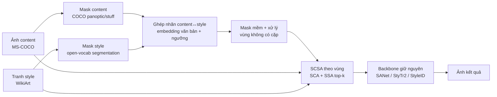

# Research Proposal

## Auto-SCSA: Semantic Continuous-Sparse Attention với tương ứng ngữ nghĩa tự động và attention theo vùng hiệu quả cho Arbitrary Semantic Style Transfer trên MS-COCO × WikiArt

> Bài báo nền: Shang et al., *SCSA*, CVPR 2025 — https://arxiv.org/abs/2503.04119 · Code: https://github.com/scn-00/SCSA
> Soạn ngày 2026-10-18. Các con số của SCSA trích từ bản PDF arXiv v1; mọi con số cho đề tài này là mục tiêu, chưa phải kết quả.

---

## 1. Tóm tắt

SCSA (CVPR 2025) cho thấy chỉ cần thay attention toàn cục bằng attention có ràng buộc nhãn ngữ nghĩa là các mô hình style transfer có sẵn (SANet, StyTr2, StyleID) chuyển style đúng vùng hơn mà không cần huấn luyện. Tuy nhiên SCSA được đánh giá trên 91 bộ dữ liệu tự tuyển với semantic map dựng tay, dùng một metric do chính tác giả đề xuất, và tốn thêm thời gian/bộ nhớ.

Đề tài này đề xuất **Auto-SCSA** với ba đóng góp:

1. **Benchmark MS-COCO × WikiArt** có semantic map, tạo bằng pipeline segmentation tự động, đủ lớn để đánh giá thống kê.
2. **Tương ứng ngữ nghĩa tự động và bền vững**: sinh mask cho tranh nghệ thuật bằng open-vocabulary segmentation, ghép nhãn content↔style bằng embedding văn bản, xử lý vùng không có cặp và mask nhiễu.
3. **Attention theo vùng hiệu quả**: tính SCA/SSA trực tiếp trên từng vùng thay vì ma trận N×N đầy đủ rồi mask, cùng biến thể SSA top-k/có nhiệt độ.

---

## 2. Đặt vấn đề

### 2.1 Bối cảnh

Attention-based Arbitrary Style Transfer (Attn-AST) để mỗi điểm content (query) lấy style từ các điểm style (key/value) theo độ tương đồng cấu trúc. Khi content và style có cùng ngữ nghĩa (ảnh phong cảnh ↔ tranh phong cảnh), cách làm này thường lấy style **sai vùng**. SCSA sửa bằng hai attention có mask nhãn:

- **SCA**: Q/K từ semantic map → mỗi điểm nhận style tổng thể của cả vùng tương ứng.
- **SSA**: Q/K từ ảnh, giữ đúng 1 key giống nhất trong cùng vùng → giữ texture sắc nét.
- Trộn: `F_cs = α1·F_sca + α2·F_ssa + F_c` (F_c sau S-AdaIN theo vùng).

### 2.2 Khoảng trống nghiên cứu

| # | Khoảng trống | Bằng chứng từ paper/code | Hệ quả |
| --- | --- | --- | --- |
| G1 | Phụ thuộc semantic map dựng tay, nhãn phải khớp nhau | Paper yêu cầu người dùng cung cấp map cùng nhãn; `sem.py` dùng bảng màu cứng theo số thư mục | Không dùng được cho ảnh mới quy mô lớn |
| G2 | Đánh giá quy mô nhỏ | 91 bộ tự tuyển, không split chuẩn, không báo độ lệch | Khó khẳng định ý nghĩa thống kê, khó so sánh lại |
| G3 | Metric chính tự đề xuất | SSL do tác giả định nghĩa, gần với cơ chế phương pháp | Rủi ro thiên vị đánh giá |
| G4 | Vùng không có cặp | Paper không mô tả trường hợp nhãn content không có bên style (hàng attention toàn −∞) | Lỗi số / kết quả không xác định |
| G5 | Chi phí tính toán | Appendix I: tốn thêm thời gian và bộ nhớ, để tối ưu sau | Khó áp dụng ảnh độ phân giải cao |
| G6 | SSA top-1 cứng | Chưa có thử nghiệm top-k hay softmax nhiệt độ | Có thể lặp texture, nhạy nhiễu, gãy ở biên vùng |
| G7 | Đánh đổi nội dung trên diffusion | CFSD của StyleID tăng 0.0916 → 0.1178 khi có SCSA | Mất chi tiết nội dung ở backbone mạnh nhất |

### 2.3 Câu hỏi nghiên cứu

- **RQ1.** SCSA có giữ được ưu thế khi đánh giá trên benchmark lớn MS-COCO × WikiArt với metric độc lập (ArtFID, LPIPS, CLIP-based) thay vì chỉ SSL không?
- **RQ2.** Thay semantic map thủ công bằng mask tự động (có nhiễu) làm chất lượng giảm bao nhiêu, và các cơ chế bền vững (ghép nhãn bằng embedding, mask mềm, fallback cho vùng không cặp) bù lại được bao nhiêu?
- **RQ3.** Attention theo vùng có cho kết quả tương đương SCSA gốc với chi phí thời gian/bộ nhớ thấp hơn đáng kể không?
- **RQ4.** SSA top-k / có nhiệt độ có cân bằng tốt hơn giữa texture sắc nét và tính liên tục trong vùng không?

### 2.4 Mục tiêu

1. Tái lập kết quả SCSA trên 3 backbone với dữ liệu gốc (sai lệch metric so với Table 1 ≤ 5%).
2. Xây benchmark MS-COCO × WikiArt có semantic map (mục tiêu ≥ 1.000 cặp đánh giá, có tập con kiểm duyệt tay).
3. Xây và đánh giá Auto-SCSA (G1, G4, G5, G6).
4. Công bố code, dữ liệu, giao thức đánh giá.

---

## 3. Tổng quan nghiên cứu liên quan

| Nhóm | Công trình tiêu biểu | Ý chính | Liên hệ với đề tài |
| --- | --- | --- | --- |
| NST tối ưu | Gatys et al., CVPR 2016 | Style = Gram matrix VGG | Cơ sở của style loss / SSL |
| AST thống kê | AdaIN (ICCV 2017), WCT (NeurIPS 2017) | Khớp thống kê toàn cục | S-AdaIN là AdaIN theo vùng |
| AST patch | Style-Swap (Chen & Schmidt, 2016) | Thay patch bằng patch style gần nhất | Tiền thân của SSA |
| Attn-AST CNN | SANet (CVPR 2019), AdaAttN (ICCV 2021) | Attention content→style trên feature VGG | Backbone 1 |
| Attn-AST Transformer | StyTr2 (CVPR 2022) | Transformer encoder–decoder | Backbone 2 |
| Attn-AST Diffusion | StyleID (CVPR 2024) | Thay K/V self-attention U-Net, training-free | Backbone 3 |
| Semantic style transfer | Neural Doodle (2016), DIA (SIGGRAPH 2017), GLStyleNet (2018), STROTSS (CVPR 2019), MAST (ICCV 2021) | Ghép vùng theo map/tương ứng | Baseline so sánh |
| Plug-and-play semantic | **SCSA (CVPR 2025)** | SCA + SSA có mask nhãn | Phương pháp nền |
| Segmentation | SAM (Kirillov et al., ICCV 2023), SAM 2 (Ravi et al., 2024), Grounded-SAM (Ren et al., 2024), COCO-Stuff/Panoptic | Mask chất lượng cao, open-vocabulary | Sinh semantic map tự động |
| Đánh giá style | ArtFID (Wright & Ommer, 2022), LPIPS (Zhang et al., CVPR 2018), CFSD (theo StyleID) | Metric style/nội dung | Bộ metric độc lập |

Cần đọc thêm trong giai đoạn 1: các phương pháp diffusion training-free mới sau StyleID (thay attention trong U-Net/DiT) để xác định backbone thứ 4 nếu còn thời gian.

---

## 4. Phương pháp đề xuất

### 4.1 Tổng quan pipeline

### 4.2 Module M1 — Sinh semantic map tự động (giải G1)

- **Content (MS-COCO):** dùng sẵn annotation panoptic/stuff của COCO (nhãn chuẩn, không cần mô hình).
- **Style (WikiArt):** không có nhãn → chạy open-vocabulary segmentation (ví dụ Grounded-SAM với danh sách nhãn COCO-Stuff, hoặc SAM 2 + phân loại vùng bằng CLIP). Đầu ra: mask + nhãn văn bản.
- **Kiểm duyệt:** tập con 200 cặp được người kiểm tra/sửa tay → làm "ground-truth map" để đo độ suy giảm do mask nhiễu (RQ2).
- **Thay `sem.py`:** đọc trực tiếp mask nhãn số (thay cho ảnh tô màu + K-Means với bảng màu cứng).

### 4.3 Module M2 — Ghép nhãn và xử lý vùng không có cặp (giải G1, G4)

- Ghép nhãn content↔style: trùng tên thì ghép; không trùng thì lấy nhãn style có độ tương đồng embedding văn bản (CLIP text) cao nhất nếu vượt ngưỡng τ (ví dụ "grass" ↔ "field").
- Vùng content vẫn không có cặp → ba phương án để so sánh:
    1. Fallback về Universal Attention toàn cục cho vùng đó.
    2. Ghép với vùng style có thống kê feature gần nhất.
    3. Giữ nguyên content (chỉ S-AdaIN toàn cục).
- **Mask mềm ở biên:** làm mờ mask bằng khoảng cách tới biên → thay −∞ bằng một penalty hữu hạn cho key khác nhãn trong dải biên, giảm răng cưa.

### 4.4 Module M3 — Attention theo vùng hiệu quả (giải G5)

Thay vì tính `Q^T K` kích thước N×M rồi mask, gom chỉ số theo nhãn và tính attention riêng cho từng vùng i:

$$
\text{Chi phí: } O(N \cdot M) \;\longrightarrow\; O\Big(\sum_i N_i \cdot M_i\Big)
$$

- **SCA:** vì các query cùng vùng có hàng attention gần giống nhau, thử xấp xỉ bằng **một vector style trung bình có trọng số cho mỗi vùng** rồi broadcast → chi phí gần O(N + M).
- **SSA:** top-1 trong vùng = tìm láng giềng gần nhất → dùng tìm kiếm k-NN theo lô (hoặc thư viện ANN như FAISS) trong từng vùng.
- Đo: thời gian, bộ nhớ GPU đỉnh ở 512, 768, 1024 px.

### 4.5 Module M4 — SSA mềm (giải G6)

$$
\bar B_{qk} =
\begin{cases} B_{qk}/T & k \in \text{top-}k \text{ của } q \text{ trong cùng nhãn} \\ -\infty & \text{ngược lại}\end{cases}
$$

- Quét k ∈ {1, 4, 16} và nhiệt độ T ∈ {0.05, 0.1, 0.5}; k = 1 trùng SCSA gốc.
- Kỳ vọng: k nhỏ giữ texture, k lớn mượt hơn ở biên; chọn cấu hình theo đường cong SSL–CFSD.

### 4.6 Giữ nguyên tính plug-and-play

Mọi module chỉ thay khối attention và tiền xử lý mask; không huấn luyện lại backbone. Siêu tham số α1, α2, b, t1, t2 giữ mặc định của SCSA khi so sánh, chỉ quét trong thí nghiệm độ nhạy.

---

## 5. Dữ liệu, thiết lập thực nghiệm & đánh giá

### 5.1 Dữ liệu

| Bộ dữ liệu | Vai trò | Nguồn mask | Quy mô dự kiến |
| --- | --- | --- | --- |
| SCSA `sem_data` (69 thư mục công bố) | Tái lập, so sánh trực tiếp với paper | Map dựng tay của tác giả | 69 bộ |
| MS-COCO (val, có panoptic/stuff) | Ảnh content | Annotation COCO | Chọn ảnh có ≥ 2 vùng lớn (ví dụ sky, grass, water, tree, building, person) |
| WikiArt | Ảnh style | Open-vocab segmentation (M1) | Lọc tranh phong cảnh/chân dung có vùng tương ứng |
| Tập kiểm duyệt | Đo ảnh hưởng mask nhiễu | Sửa tay | 200 cặp |
| Benchmark đánh giá chính | RQ1–RQ4 | Tự động | ≥ 1.000 cặp content–style ghép theo tỉ lệ chồng nhãn |

Quy tắc ghép cặp: một cặp hợp lệ khi các nhãn chung phủ ≥ 60% diện tích ảnh content (ngưỡng sẽ hiệu chỉnh ở giai đoạn 2).

### 5.2 Baseline

- SANet, StyTr2, StyleID (gốc).
- SANet/StyTr2/StyleID + SCSA (map tự động và map kiểm duyệt).
- SANet/StyTr2/StyleID + Auto-SCSA (các biến thể M2–M4).
- Tuỳ khả năng chạy lại code: STROTSS, MAST (semantic style transfer).

### 5.3 Metric

| Khía cạnh | Metric | Ghi chú |
| --- | --- | --- |
| Style theo vùng | SSL (theo SCSA) | Giữ để so sánh với paper |
| Style tổng thể | FID, ArtFID | ArtFID kết hợp style fidelity và content |
| Giữ nội dung | CFSD, LPIPS | CFSD theo StyleID |
| Ngữ nghĩa | Độ tương đồng CLIP giữa vùng kết quả và vùng style cùng nhãn | Metric độc lập với SSL |
| Biên vùng | Gradient/artifact trong dải biên mask | Đo hiệu quả mask mềm |
| Hiệu năng | Thời gian/ảnh, bộ nhớ GPU đỉnh | Ở 512, 768, 1024 px |
| Chủ quan | User study: so cặp + xếp hạng | ≥ 30 người, mỗi người ≥ 20 câu |

Báo cáo trung bình ± độ lệch chuẩn, kiểm định thống kê (ví dụ Wilcoxon signed-rank) giữa từng cặp có/không module.

### 5.4 Thí nghiệm

| ID | Câu hỏi | Thiết kế |
| --- | --- | --- |
| E1 | Tái lập | Chạy 3 backbone ± SCSA trên `sem_data`, so với Table 1 |
| E2 | RQ1 | 3 backbone ± SCSA trên benchmark COCO × WikiArt, đủ bộ metric |
| E3 | RQ2 | SCSA với map kiểm duyệt vs map tự động; + M2 (ghép nhãn, fallback, mask mềm) |
| E4 | RQ3 | SCSA gốc vs M3 attention theo vùng: chất lượng + thời gian/bộ nhớ theo độ phân giải |
| E5 | RQ4 | Quét k, T của M4 |
| E6 | Độ nhạy | Quét α1, α2 (và b, t1) trên benchmark mới |
| E7 | User study | Auto-SCSA vs SCSA vs backbone gốc |

---

## 6. Kế hoạch & timeline (16 tuần, tính từ tuần bắt đầu)

| Giai đoạn | Tuần | Công việc | Đầu ra / mốc kiểm tra |
| --- | --- | --- | --- |
| 1. Nắm vững & tái lập | 1–3 | Đọc paper + code, cài 3 backbone, chạy `sem.py`, E1 | Bảng tái lập; **Mốc 1:** sai lệch ≤ 5% so với Table 1 |
| 2. Xây benchmark | 4–6 | Lọc COCO, segmentation WikiArt, ghép cặp, kiểm duyệt 200 cặp | Benchmark v1 + tập kiểm duyệt; **Mốc 2:** ≥ 1.000 cặp |
| 3. Đánh giá mở rộng | 7–8 | E2, E3 (phần map tự động vs kiểm duyệt) | Trả lời RQ1, nửa đầu RQ2 |
| 4. Phát triển module | 9–12 | M2 (ghép nhãn, fallback, mask mềm), M3 (attention theo vùng), M4 (top-k) | Code Auto-SCSA; **Mốc 3:** M3 nhanh hơn rõ rệt ở 1024 px |
| 5. Thí nghiệm đầy đủ | 13–14 | E3–E7, user study | Bảng kết quả + kiểm định thống kê |
| 6. Viết & công bố | 15–16 | Báo cáo/bài báo, dọn code, công bố benchmark | Bản thảo + repo công khai |

Phần việc song song: tuần 4–6 vừa xây benchmark vừa viết khung M3 (không phụ thuộc dữ liệu).

---

## 7. Kết quả kỳ vọng, rủi ro & phương án dự phòng

### 7.1 Kết quả kỳ vọng

- Benchmark semantic style transfer MS-COCO × WikiArt có mask, giao thức đánh giá công khai.
- Phân tích độc lập về SCSA trên dữ liệu lớn với metric không do tác giả đề xuất.
- Auto-SCSA: chạy được với ảnh bất kỳ không cần vẽ map tay; giảm thời gian/bộ nhớ so với SCSA gốc ở độ phân giải cao; giữ hoặc cải thiện SSL/ArtFID.

### 7.2 Rủi ro

| Rủi ro | Khả năng | Ảnh hưởng | Phương án dự phòng |
| --- | --- | --- | --- |
| Segmentation trên tranh nghệ thuật kém (domain gap) | Cao | Map nhiễu làm hỏng kết quả | Giới hạn nhóm nhãn dễ (sky, water, tree, grass, mountain, person); tăng tỉ lệ kiểm duyệt tay; đây cũng chính là dữ kiện cho RQ2 |
| Không tái lập được số của paper | Trung bình | Mất mốc so sánh | Mở issue/hỏi tác giả; báo cáo số tự chạy làm baseline nội bộ |
| Thiếu GPU cho StyleID ở độ phân giải cao | Trung bình | Không làm được E4 đầy đủ | Ưu tiên SANet/StyTr2; StyleID chỉ chạy 512 px |
| SCA xấp xỉ theo vùng làm giảm chất lượng | Trung bình | M3 kém hơn bản gốc | Giữ bản tính chính xác theo vùng (vẫn nhanh hơn N×M đầy đủ) |
| Code gốc khác mô tả trong paper | Thấp–TB | Hiểu sai cơ chế | Đọc code trước (giai đoạn 1), ghi chú khác biệt |
| Bản quyền ảnh WikiArt khi công bố | Trung bình | Không công bố được ảnh | Chỉ công bố danh sách ID/URL + mask, không phân phối lại ảnh |

---

## 8. Tài liệu tham khảo

1. C. Shang, H. Wang, Z. Wang, X. Meng. *SCSA: A Plug-and-Play Semantic Continuous-Sparse Attention for Arbitrary Semantic Style Transfer.* CVPR 2025. https://arxiv.org/abs/2503.04119 · https://github.com/scn-00/SCSA
2. L. A. Gatys, A. S. Ecker, M. Bethge. *Image Style Transfer Using Convolutional Neural Networks.* CVPR 2016.
3. X. Huang, S. Belongie. *Arbitrary Style Transfer in Real-time with Adaptive Instance Normalization.* ICCV 2017.
4. Y. Li et al. *Universal Style Transfer via Feature Transforms.* NeurIPS 2017.
5. T. Q. Chen, M. Schmidt. *Fast Patch-based Style Transfer of Arbitrary Style.* arXiv:1612.04337, 2016.
6. D. Y. Park, K. H. Lee. *Arbitrary Style Transfer with Style-Attentional Networks (SANet).* CVPR 2019.
7. S. Liu et al. *AdaAttN: Revisit Attention Mechanism in Arbitrary Neural Style Transfer.* ICCV 2021.
8. Y. Deng et al. *StyTr2: Image Style Transfer with Transformers.* CVPR 2022.
9. J. Chung, S. Hyun, J.-P. Heo. *Style Injection in Diffusion: A Training-free Approach for Adapting Large-scale Diffusion Models for Style Transfer (StyleID).* CVPR 2024.
10. A. J. Champandard. *Semantic Style Transfer and Turning Two-Bit Doodles into Fine Artworks.* arXiv:1603.01768, 2016.
11. J. Liao et al. *Visual Attribute Transfer through Deep Image Analogy.* SIGGRAPH 2017.
12. N. Kolkin, J. Salavon, G. Shakhnarovich. *Style Transfer by Relaxed Optimal Transport and Self-Similarity (STROTSS).* CVPR 2019.
13. J. Huo et al. *Manifold Alignment for Semantically Aligned Style Transfer (MAST).* ICCV 2021.
14. Z. Wang et al. *GLStyleNet: Higher Quality Style Transfer Combining Global and Local Pyramid Features.* arXiv 2018.
15. T.-Y. Lin et al. *Microsoft COCO: Common Objects in Context.* ECCV 2014. · H. Caesar et al. *COCO-Stuff.* CVPR 2018.
16. A. Kirillov et al. *Segment Anything.* ICCV 2023. · N. Ravi et al. *SAM 2.* arXiv 2024. · T. Ren et al. *Grounded SAM.* arXiv 2024.
17. M. Wright, B. Ommer. *ArtFID: Quantitative Evaluation of Neural Style Transfer.* GCPR 2022.
18. R. Zhang et al. *The Unreasonable Effectiveness of Deep Features as a Perceptual Metric (LPIPS).* CVPR 2018.
19. J. Song, C. Meng, S. Ermon. *Denoising Diffusion Implicit Models.* ICLR 2021. · R. Rombach et al. *High-Resolution Image Synthesis with Latent Diffusion Models.* CVPR 2022.
