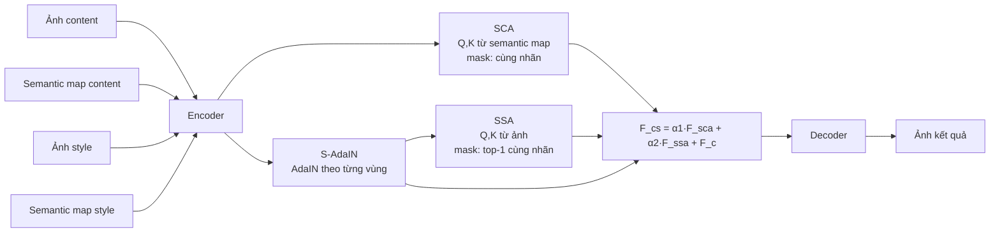

# SCSA: Semantic Continuous-Sparse Attention

> **SCSA: A Plug-and-Play Semantic Continuous-Sparse Attention for Arbitrary Semantic Style Transfer** (CVPR 2025, Highlight)
> Chunnan Shang, Hongwei Wang, Zhizhong Wang, Xiangming Meng · Zhejiang University
> Paper: https://arxiv.org/abs/2503.04119 · Code: https://github.com/scn-00/SCSA

**Ý chính:** SCSA thay khối attention toàn cục (Universal Attention, UA) trong các mô hình style transfer dựa trên attention bằng hai attention có ràng buộc nhãn ngữ nghĩa, là **SCA** và **SSA**. Phương pháp **không cần huấn luyện lại**. Kết quả: vùng "trời" trong ảnh kết quả chỉ lấy style từ vùng "trời" của tranh, vùng "cỏ" chỉ lấy từ vùng "cỏ".

---

## 1. Bài toán

**Arbitrary Semantic Style Transfer:** đầu vào gồm bốn thành phần `{I_c, I_csem, I_s, I_ssem}`: ảnh content và semantic map của nó, ảnh style và semantic map của nó. Mô hình cần sinh ảnh `I_cs` thỏa hai điều kiện:

- giữ nội dung của `I_c`;
- style của mỗi vùng ngữ nghĩa khớp với **vùng cùng nhãn** trong `I_s`.

Các phương pháp style transfer dựa trên attention (Attn-AST) như **SANet** (CNN), **StyTr2** (Transformer) và **StyleID** (Diffusion) đều dùng attention toàn cục:

$$
Q = f_q(\bar F_c),\quad K = f_k(\bar F_s),\quad V = f_v(F_s),\quad
F_{cs} = f_o\big(\mathrm{softmax}(Q^\top K)\, V\big) + F_c
$$

Ở đây mỗi điểm content (query) nhìn vào **mọi** điểm style (key) và chỉ xét độ giống nhau về cấu trúc, không xét nhãn vùng.

## 2. Ba lỗi của Universal Attention

| # | Lỗi | Hệ quả | SCSA sửa bằng |
| --- | --- | --- | --- |
| 1 | Query chú ý tới mọi key style, bỏ qua nhãn vùng | Lấy style sai vùng, sinh artifact | Mask theo nhãn |
| 2 | Style phụ thuộc cấu trúc cục bộ: hai điểm cạnh nhau có cấu trúc hơi khác sẽ nhận style khác nhau | Một vùng cùng nghĩa bị stylize không liên tục | **SCA** |
| 3 | Đầu ra là trung bình có trọng số của nhiều điểm style | Texture bị làm mờ, kém sống động | **SSA** |

## 3. Phương pháp

SCSA chỉ thay khối UA. Encoder, decoder và trọng số của backbone giữ nguyên, nên phương pháp **plug-and-play**.

### 3.1 Semantic Continuous Attention (SCA): style tổng thể của vùng

$$
Q_1 = f_q(\bar F_{csem}),\quad K_1 = f_k(\bar F_{ssem}),\quad V_1 = f_v(F_s)
$$

$$
\bar A_{qk} =
\begin{cases} (Q_1^\top K_1)_{qk} & \text{nếu } q, k \text{ cùng nhãn} \\ -\infty & \text{ngược lại}\end{cases}
\qquad
F_{sca} = f_o\big(\mathrm{softmax}(\bar A)\, V_1\big)
$$

- Q và K lấy từ feature của **semantic map**, không lấy từ ảnh. Semantic map không mang cấu trúc ảnh, nên mọi điểm trong cùng một vùng có hàng attention gần như giống nhau.
- Sau khi mask, trọng số trải đều lên **toàn bộ** vùng style tương ứng ("continuous"). Nhờ vậy cả vùng nhận cùng màu và tông, sửa lỗi #2.
- V vẫn lấy từ ảnh style, nên thông tin style thực sự vẫn đến từ tranh.

### 3.2 Semantic AdaIN (S-AdaIN)

S-AdaIN tách semantic map thành mặt nạ của từng lớp (bằng K-Means), rồi áp AdaIN **riêng cho từng vùng**: thống kê mean/std của vùng *i* bên content được khớp với vùng *i* bên style. Bước này giảm ảnh hưởng của style vốn có trong ảnh content, cho SSA một query sạch hơn.

### 3.3 Semantic Sparse Attention (SSA): texture cụ thể

$$
Q_2 = f_q(\bar F_c^{\,S\text{-}AdaIN}),\quad K_2 = f_k(\bar F_s),\quad V_2 = f_v(F_s)
$$

$$
\bar B_{qk} =
\begin{cases} B_{qk} & \text{nếu } B_{qk} = \max_{n\,\in\,\text{cùng nhãn}} B_{qn} \\ -\infty & \text{ngược lại}\end{cases}
\qquad
F_{ssa} = f_o\big(\mathrm{softmax}(\bar B)\, V_2\big)
$$

- Q và K là feature của ảnh, nên SSA so khớp theo cấu trúc, nhưng **chỉ trong cùng vùng**.
- Mask chỉ giữ **một key** (top-1), nên softmax trở thành one-hot: mỗi điểm sao chép nguyên value của điểm style giống nó nhất ("sparse"). Texture vì thế giữ được độ sắc, sửa lỗi #3. Có thể hiểu SSA là Style-Swap giới hạn trong từng vùng ngữ nghĩa.

### 3.4 Phép trộn

$$
F_{cs} = \alpha_1 F_{sca} + \alpha_2 F_{ssa} + F_c
$$

`α1` điều chỉnh mức style tổng thể (màu, tông), `α2` điều chỉnh độ sắc của texture, `F_c` là feature content sau S-AdaIN.

## 4. Cắm vào các backbone

| Backbone | Họ | Vị trí thay UA | Siêu tham số mặc định |
| --- | --- | --- | --- |
| SANet | CNN (VGG-19) | Khối SANet | α1 = 0.7, α2 = 0.3 |
| StyTr2 | Transformer | Các transformer chẵn của decoder | α1 = 1.2, α2 = 0.5, b = 0.7 |
| StyleID | Diffusion (LDM U-Net) | Self-attention của U-Net sau DDIM inversion | α1 = 0.8, α2 = 0.2, t1 = 0.3, t2 = 0.5 |

Với StyleID, Q/K của SCA không lấy thuần từ semantic map mà trộn với feature ảnh theo hệ số t1, còn Q của SSA trộn theo t2. S-AdaIN chỉ dùng ở bước t = T.

## 5. Kết quả

**Thiết lập:** 91 bộ dữ liệu do tác giả tự tuyển, semantic map dựng tay. Có bốn metric:

- **SSL** (Semantic Style Loss, ↓): style loss Gram tính theo từng vùng, do tác giả đề xuất.
- **FID** (↓): mức khớp style tổng thể.
- **CFSD** (↓): mức giữ nội dung.
- **Pref.** (↑): user study với 1.200 phiếu.

| Phương pháp | SSL ↓ | FID ↓ | CFSD ↓ | Pref. ↑ |
| --- | --- | --- | --- | --- |
| SANet | 1.6583 | 14.3385 | 0.1103 | 0.1685 |
| **SANet + SCSA** | **0.8762** | 13.0788 | 0.0874 | 0.8315 |
| StyTr2 | 1.9826 | 12.5273 | 0.0752 | 0.1576 |
| **StyTr2 + SCSA** | 1.2228 | **12.3963** | **0.0705** | 0.8424 |
| StyleID | 1.7538 | 12.5944 | 0.0916 | 0.2192 |
| **StyleID + SCSA** | 1.2447 | 12.4497 | 0.1178 | 0.7808 |
| STROTSS | 1.0981 | 12.8400 | 0.1008 | 0.1867 |
| MAST | 1.7320 | 16.5163 | 0.0746 | 0.1100 |
| TR | 1.2631 | 13.5846 | 0.1149 | 0.0450 |
| DIA | 1.9398 | 20.7942 | 0.1147 | 0.0167 |
| GLStyleNet | 1.0305 | 14.4880 | 0.3991 | 0.1183 |

- SCSA giảm SSL mạnh trên cả ba backbone. Với SANet, SSL giảm khoảng 47%, đạt mức tốt nhất toàn bảng.
- FID giảm nhẹ trên cả ba backbone. StyTr2 + SCSA tốt nhất về FID và CFSD.
- **Ngoại lệ:** CFSD của StyleID + SCSA tăng từ 0.0916 lên 0.1178. Tác giả chấp nhận hy sinh một phần nội dung để stylize đúng ngữ nghĩa hơn.

**Ablation:** SCA chuyển được màu và tông tổng thể nhưng mất texture. SSA chuyển được texture nhưng màu lệch giữa các vùng. Hai thành phần bổ trợ nhau. Bỏ S-AdaIN làm CFSD tốt lên nhưng chất lượng stylize giảm.

## 6. Hạn chế

- Cần semantic map do người dùng cung cấp, với **nhãn khớp nhau** giữa content và style.
- Tốn thêm thời gian và bộ nhớ so với backbone gốc, vì vẫn tính ma trận attention N×N đầy đủ rồi mới mask.
- Hiệu quả phụ thuộc backbone: backbone chuyển style càng mạnh thì hiệu ứng càng rõ.
- Đánh giá quy mô nhỏ (91 bộ). Metric chính SSL do tác giả tự đề xuất.
- Paper không nói rõ cách xử lý vùng content không có nhãn tương ứng bên style. Khi đó cả hàng attention bị mask thành −∞, nên softmax không xác định.
- Top-1 cứng trong SSA có thể gây lặp texture và nhạy với nhiễu.

## Tham khảo

- Shang et al., *SCSA*, CVPR 2025: [arXiv 2503.04119](https://arxiv.org/abs/2503.04119)
- Park & Lee, *SANet*, CVPR 2019
- Deng et al., *StyTr2*, CVPR 2022
- Chung et al., *StyleID*, CVPR 2024
- Huang & Belongie, *AdaIN*, ICCV 2017
- Chen & Schmidt, *Style-Swap*, 2016
